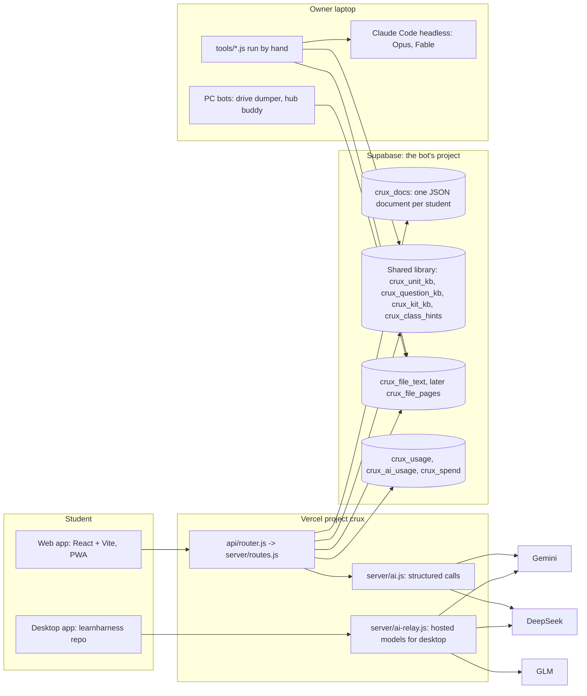
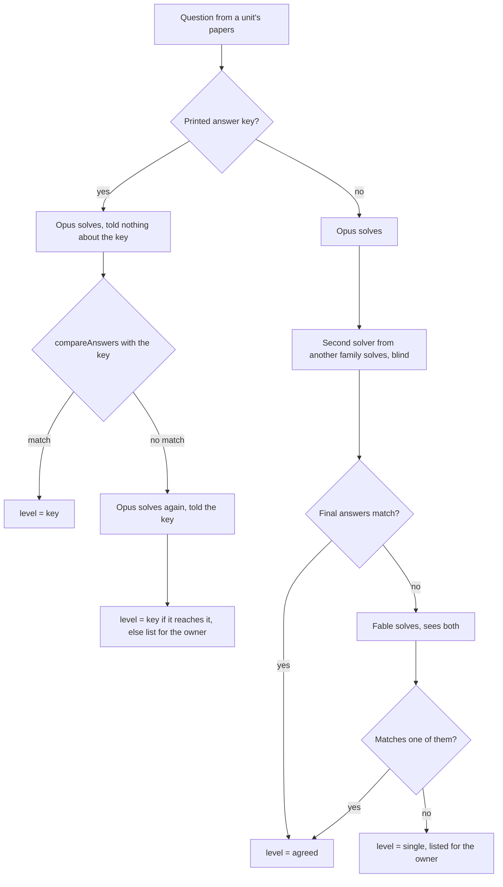

# Crux: architecture

Written 2026-11-15 from the code as it stands (232 tests pass). When the code and this file disagree, trust the code and fix this file. The short version is `ARCHITECTURE-ESSENTIALS.md`; read that one in build sessions.

## 1. System



- **Hosting.** Vercel serverless functions, one entry (`api/router.js`). No long-running server. Functions have a time limit, so long work (reading books, solving a unit's papers) runs on the owner's laptop through `tools/`.
- **Sign-in.** Discord OAuth. The session cookie is signed with `CRUX_SESSION_SECRET`. The tier comes from the Discord role and is checked again once a day (`server/auth.js`).
- **Database.** Supabase Postgres, the same project as the Discord bot. Row level security is on with no policies, so only the service key reads or writes. The service key stays on the server.
- **Web app.** React, plain CSS tokens, CSS-only motion, system fonts plus self-hosted Fraunces and Manrope. A service worker keeps every opened screen for offline use; changes that need no AI wait in an outbox.

## 2. Tech stack

Node ES modules, 2 spaces, single quotes. Dependencies are few on purpose: `dotenv`, `jszip`, `katex`, `mammoth`, `pdfjs-dist`. Tests use `node --test`. Screens are checked with `tools/shots.js` (Playwright with system Edge) and `tools/a11y.js` (axe).

Add a dependency only when a phase names it.

## 3. Data

### 3.1 The student document (`crux_docs`, private)

One JSON document per student (`server/store.js`). In production each request gets its own copy through `withDoc()`, and the router saves it once at the end. Lists: `topics, sessions, papers, teach, questions, mocks, subtopics, hints, paperq, materials, stickies, marks`, plus `units` and settings. `VERSION` in `store.js` is the data format; raise it with a `normalize` step when a list changes shape.

Notes are in `crux_notes`, loaded into the request only for routes in `READS_NOTES`.

### 3.2 The shared library (class-wide)

| Table | Key | Holds | Written by |
|---|---|---|---|
| `crux_unit_kb` | unit code | topic list in outline order | first student with 3+ topics, or the owner |
| `crux_question_kb` | sha1(unit + question wording) | worked checkpoints | first student's AI solve; after E1 also `tools/gold.js` |
| `crux_kit_kb` | unit, kind, stage, topic | ladders, recipes, guides | first student's AI call |
| `crux_class_hints` | id | lecturer hints the class heard | students |
| `crux_file_text` | file id | extracted text, page starts, section headings | prepare on first open, or `tools/prepare-unit.js` |

Rule: shared rows hold material that comes from Hub files and papers. A student's ratings, attempts, notes and learner file are never shared.

### 3.3 Changes in this round

```sql
-- E1: check level and origin of a shared solution
alter table crux_question_kb add column if not exists level   text not null default 'single' check (level in ('key', 'agreed', 'single'));
alter table crux_question_kb add column if not exists model   text;          -- e.g. 'opus', 'gemini-3.8-flash'
alter table crux_question_kb add column if not exists answer  text;          -- the final answer as text, for the agreement check
alter table crux_question_kb add column if not exists flagged integer not null default 0;  -- students who disputed the checkpoints

-- E7: page-level text with full-text search
create table if not exists crux_file_pages (
  file_id   bigint not null references files (id) on delete cascade,
  page      integer not null,
  unit_code text not null,
  text      text not null,
  tsv       tsvector generated always as (to_tsvector('english', text)) stored,
  primary key (file_id, page)
);
create index if not exists crux_file_pages_tsv_idx  on crux_file_pages using gin (tsv);
create index if not exists crux_file_pages_unit_idx on crux_file_pages (unit_code);
alter table crux_file_pages enable row level security;

-- E8: class record per sub-topic, written nightly, read only when students >= 5
create table if not exists crux_cohort (
  unit_code text not null,
  topic     text not null,            -- names, not ids: topic ids are private to each student
  subtopic  text not null default '',
  students  integer not null,
  weakness  real not null,            -- mean of (1 - U_lo)
  errors    jsonb not null default '{}',   -- { 'units': 7, 'sign-convention': 3 }
  updated_at timestamptz not null default now(),
  primary key (unit_code, topic, subtopic)
);
alter table crux_cohort enable row level security;
```

All SQL goes at the end of `supabase/crux.sql`. The Supabase MCP cannot reach the bot's project, so the owner runs new SQL in the Supabase SQL editor (an owner action in each phase).

The learner file (E5) and review state (E2) need no table. Both are computed from the student document. Only the student's own edits to the learner file are stored, in the document as `learner: { notes: [], hidden: [] }`.

## 4. AI

### 4.1 Per-student calls (in the request path)

Every call goes through `structured()` in `server/ai.js`: a JSON schema, a system prompt, the content. Providers: Gemini (default), DeepSeek (Mimosa and Acrux, capped by `DEEPSEEK.monthlyCapUsd`). A POST to a route in `USES_AI` counts one AI action against the tier's daily limit (`server/usage.js`).

The desktop app talks to `server/ai-relay.js`, which exposes Gemini, DeepSeek and GLM in the OpenAI format with per-plan models, effort and a daily count.

### 4.2 Shared-content calls (owner's laptop, never on Vercel)

`CRUX_AI=claude-code` sends `structured()` calls to a headless Claude Code run (`claudeCodeCall`): the owner's Claude plan, no API key. `CRUX_CLAUDE_MODEL` picks the model (`opus`, `fable`, `sonnet`). It refuses to run when `VERCEL` is set.

Use of each model:

| Model | Work | Where |
|---|---|---|
| Fable 5.2 | Plans. End-of-track review. Third opinion when two solvers disagree. Rewrites of the prompts for the cheap models (E6). | Claude Code sessions; `tools/gold.js --referee` |
| Opus 5.5 | Building each phase. First solver for gold solutions. | Claude Code sessions; `tools/gold.js` |
| GLM 5.3 or DeepSeek V4 Pro | Second solver for gold solutions. A different model family makes agreement mean more. | `tools/gold.js`, with the keys in `study/.env` |
| Gemini Flash, DeepSeek Flash, GLM Flash | Everything per student. | Vercel |

### 4.3 Gold solutions (E1)



- Comparison is code: `compareAnswers` in `server/answer.js` (value, unit, tolerance). Questions with no numeric answer (derivations, definitions) cannot be compared; they are stored as `single` with `model` set, and the app says "not double-checked".
- **Write rule** (pure, in `server/gold.js`): a new solution replaces the stored one only when its level is higher, or the levels are equal and the stored one has `flagged >= 3`. Order: `key` > `agreed` > `single`. A student's cheap-model solve is always `single`.
- **Budget.** Headless runs use the owner's plan allowance. The tool takes `--limit N`, saves after every question, skips questions already at `key` or `agreed`, and stops cleanly on a rate-limit error with a count of what is left.

### 4.4 Prompt safety rules

- A prompt gets file text and the student's own record. It never gets another student's data.
- The learner file block is at most 600 characters and is built by code.
- Text selected by a student (E4) goes in the content, never in the system prompt, and is capped at 2,000 characters.

## 5. Understanding and reviews

`server/understanding.js` is the Breakpoint model (see `UNDERSTANDING.md`). It gives each topic `U`, a floor `lo`, a status colour and `lastsDays`. It already contains forgetting with a half-life that spaced practice lengthens. **Do not add a second scheduler** (no SM-2, no FSRS).

Reviews (E2) are a pure function over that output, in `server/review.js`:

- A topic is **due** when its status is green and `lastsDays <= 2`.
- Order: soonest paper first, then lowest `lastsDays`.
- At most 2 a day. Count the ones already done today from the attempts' dates.
- Skip a unit whose paper has passed. During the last 3 days before any paper, offer reviews for that paper's unit only.
- A review is one question on the topic: not attempted first, then least recently attempted. Prefer questions whose shared solution is `key` or `agreed`.
- `server/next.js` gains the kind `review`. It ranks after `prepare` and `audit` and before `practise`.

## 6. File map for this round

New files exist as stubs with a header comment. Fill them in their phase.

```
study/
  AGENTS.md                      agent instructions (CLAUDE.md points here)
  docs/PRD.md  ARCHITECTURE.md  ARCHITECTURE-ESSENTIALS.md
  server/
    gold.js          E1  pure: check level, write rule, run report
    review.js        E2  pure: which topics are due, which question to ask
    learner.js       E5  pure: the learner file from a student document
    search.js        E7  page search over crux_file_pages (and an in-memory version for tests)
    cohort-priors.js E8  pure: class record -> prior for an untested sub-topic
    anki.js          E9  pure: cards -> Anki import text
  tools/
    gold.js          E1  CLI: solve a unit's past-paper questions with strong models
    eval-solve.js    E6  CLI: score a model and prompt on questions with printed answers
    pages.js         E7  CLI: fill crux_file_pages for a unit
    retrieval-eval.js E7 CLI: recall@k and MRR for the page search
  test/
    gold.test.js  review.test.js  learner.test.js  search.test.js  (one per pure module, written first)
    fixtures/evals/        E6  questions with printed answers
    fixtures/retrieval/    E7  student questions with the pages that answer them
  web/src/
    DoneBar.jsx      E3  what changed, Next
    AskPassage.jsx   E4  the Ask sheet for selected text
    AboutYou.jsx     E5  Settings: what Crux knows about you
```

Changed files, by phase: `server/shared.js`, `server/practice.js`, `web/src/Solution.jsx` (E1); `server/next.js`, `web/src/Today.jsx` (E2); `web/src/App.jsx`, `web/src/LimitNote.jsx` (E3); `web/src/StickyBar.jsx`, `server/routes.js` (E4); `server/brain.js`, `server/coach.js`, `server/guide.js`, `web/src/Settings.jsx` (E5); `server/brain.js` prompts (E6); `server/learn.js`, `server/ingest.js`, `pc/` uploader (E7); `server/plan.js`, `api/` cron (E8).

## 7. Code taken from DeepTutor

DeepTutor (github.com/HKUDS/DeepTutor) is Apache-2.0. Two things are ported, and each ported file starts with a comment naming the source file and the licence:

- `services/rag/eval/metrics.py` -> the metric functions in `tools/retrieval-eval.js` (recall@k, MRR, nDCG).
- `notes/anki_export.py` -> the format in `server/anki.js` (Anki 2.1.55+ header lines, stable GUIDs).

Everything else from DeepTutor is an idea, not code: review ordering, the visible learner file, the rule that a model never awards mastery. Crux's own model already covers DeepTutor's mastery score, grading and scheduler; see `deeptutor-copy-list.md`.

## 8. What will break, and the answer

| Risk | Answer |
|---|---|
| A wrong gold solution reaches the whole class. | Check levels (4.3); the level is shown; 3 student flags let a new solve replace it; the owner gets the list of `single` and disagreed questions after each run. |
| The Claude plan allowance runs out mid-run. | `--limit`, save per question, resume, clean stop (4.3). Run one unit per sitting. |
| The headless model alias is wrong (`fable`). | E0 checks `claude -p --model fable` and `--model opus` once and records the working names. |
| Using a personal Claude plan to make study material for paying students. | The app already uses this path for OCR. Read the plan's terms once (owner action in E0). The clean route later is an API key in `ai.js`. |
| Reviews crowd out exam work. | Cap of 2, unit filter in the last 3 days (section 5). |
| The question key changes when a paper is re-parsed (the key is the wording). | `tools/gold.js` reads questions through the same parser the app uses (`parsePapers` in `server/weakspots.js`, which works on the local owner document and `library.json`), and reports how many stored keys no longer match a question. |
| Full-text search misses symbols and formulas. | E7 measures recall on real questions before `learn.js` switches. Keep the current path when FTS scores lower. |
| The learner file says something wrong about a student. | It is built from counted events only, shows its evidence, and the student can hide any line. |
| Large Supabase rows and egress. | Page rows replace loading whole files. Check row counts against the free plan in E7 before the backfill. |
| Offline outbox and new routes. | New write routes that need no AI (hide a learner line, mark a review done) are added to the `QUEUE` pattern in `web/src/api.js` (the offline outbox). |

## 9. Checked and dropped

- **Embeddings and pgvector.** More moving parts and a provider dependency. Full-text search first.
- **A spaced-repetition scheduler from DeepTutor.** The Breakpoint model already forgets.
- **A flashcard system.** Crux is about solving papers. Anki export covers the students who want cards.
- **Stale-content fingerprints for shared kits.** `tools/gold.js` is keyed by question, so new papers are picked up on the next run. Guides can be remade with the existing "Make a fresh one".
- **Batch API, Managed Agents, any Claude API feature.** No API key in this round.
