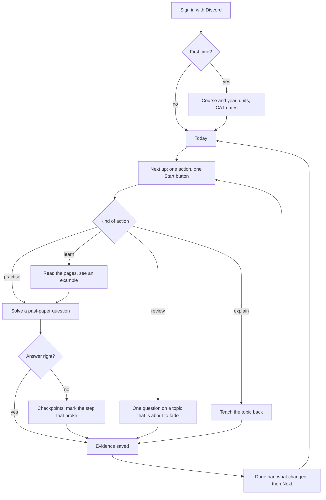

# Crux: product requirements

Written 2026-11-15. This file says what Crux is for and what it must do. The technical design is in `ARCHITECTURE.md`. The build order is in `fixplan-e.md` (repo root, local only).

## 1. What Crux is

Crux is the Engineering Study Hub's study app at crux.engineeringhub.site. It prepares a student for a CAT or exam in a unit, using the unit's own files and past papers from the Hub's Discord. It finds where the student's reasoning breaks and sends them to that step.

## 2. Who uses it

- **Students** at Kenyatta University, mostly engineering, in the Study Hub Discord. They study on a phone first and a laptop second. Data is costly and the connection drops. Most start a few days before a paper.
- **The owner.** One person runs the Hub, the bots and Crux from one laptop. There is no server team and no ops budget.

## 3. Plans (set on 13 Nov 2026)

| Plan | Tier id | AI actions a day | Downloads a day | Hosted models |
|---|---|---|---|---|
| Imai (free trial) | `trial` | 15 | 2 | Gemini Flash, low effort |
| Gacrux | `basic` | 15 | 2 | Gemini Flash, low effort |
| Mimosa | `premium` | 40 | unlimited | Gemini, DeepSeek Flash, GLM Flash, medium effort |
| Acrux (KES 999 a semester) | `vvip` | 80 | unlimited | every model, any effort |

The numbers live in `server/defs.js` and `server/ai-relay.js`. Change them there.

## 4. The problem this round solves

Crux works, but four things hold it back.

1. **The worked solutions are only as good as the cheapest model.** The first student to open a question pays for a Gemini Flash solve, and every later student gets that same solve. Nobody checks it. A wrong shared solution misleads the whole class.
2. **Understanding fades and Crux does not bring it back.** The Breakpoint model already knows when a green topic will fade ("lasts about N days"). Today never asks the student to revisit it.
3. **The AI does not know the student.** Every explanation starts from zero, although Crux holds the student's recurring mistakes.
4. **The flow has gaps.** After one task the student goes back to Today to find the next. A student cannot ask about a passage they are reading. The daily AI allowance is invisible until it runs out.

## 5. Principles

1. **Do it once per unit, share it with the class.** The strong models (Opus, Fable) work on shared material: solutions, topic lists, guides. The cheap models work per student.
2. **Code decides, the model explains.** Marking, mastery, scheduling and limits are code. A model never awards understanding.
3. **Shared material comes from Hub files only.** Nothing a student typed about themselves is ever shared.
4. **Zero new running costs.** No new paid service. Strong-model work runs through Claude Code on the owner's laptop.
5. **Phone first, offline friendly.** Every new screen works at 375 px and keeps working from the cache.
6. **Plain words.** Copy follows fixplan Appendix E. No slogans.

## 6. The user flow (target)

Step by step:

1. **Sign in** with Discord. The plan comes from the Discord role.
2. **First run** (three steps, exists): course and year, units, CAT dates. A unit that the owner has prepared shows "Ready": its topics are listed and its past-paper questions are solved. The student has nothing to set up.
3. **Today** shows one Next up action with Start, then a short list. New: a **review** action when a green topic is about to fade, and a line that says how many AI actions are left today.
4. **Learn** a topic from the unit's own pages (exists). New: select any passage and choose **Ask**. The answer uses that passage and the student's file.
5. **Practise** a past-paper question (exists). The final answer is checked in code. When it is wrong, the student sees numbered checkpoints and marks the step that broke. New: each solution shows how it was checked (printed answer, two solvers agree, or not double-checked).
6. **Done bar.** New: after any task, a bar says what changed ("Torsion: amber to green") and offers Next. The student does not go back to Today to continue.
7. **Exam week.** Today leads with the paper: predicted topics, a timed paper, the unit's sheet (exists). New: reviews stop for other units during the last 3 days.
8. **Settings** has a new part: "What Crux knows about you". The student reads it, edits it or deletes it.

## 7. Requirements

Each one names its phase in `fixplan-e.md`.

| # | Requirement | Phase | Need |
|---|---|---|---|
| R1 | Past-paper questions of a prepared unit have a worked solution made by a strong model before students arrive. | E1 | must |
| R2 | Every shared solution carries a check level: `key` (matches the printed answer), `agreed` (two different models reach the same answer), `single` (not double-checked). The student sees it. | E1 | must |
| R3 | A cheap-model solve never replaces a `key` or `agreed` solution. | E1 | must |
| R4 | Today offers a review when a green topic will fade within 2 days. At most 2 reviews a day. None in the last 3 days before a paper in another unit. | E2 | must |
| R5 | After a task, the student can go to the next action without opening Today. | E3 | must |
| R6 | The student always sees how many AI actions are left today. | E3 | should |
| R7 | The student can select text in a file, a solution or a guide and ask about it. One question is one AI action. | E4 | should |
| R8 | Crux keeps a short file about the student, built in code from their record. It is added to explain, ask and guide prompts. The student can read, edit and delete it. | E5 | should |
| R9 | The prompts for the cheap models are measured against questions with printed answers. A prompt changes only when the score goes up. | E6 | should |
| R10 | A topic search reads matching pages, not whole files. Whole books are covered, not the first 100 pages. | E7 | should |
| R11 | A new student's untested topics start from the class's record when 5 or more students have one. | E8 | later |
| R12 | A unit's formulas and missed questions can be exported for Anki. | E9 | could |

## 8. Not in this round

- A Claude API key. The minimum top-up is too high for now. Claude can be added to `ai-relay.js` later as one more provider.
- Vector search and embeddings. Postgres full-text search comes first; measure it before adding more.
- Video lessons, research reports, a math animator, multi-agent solving. They cost too many tokens for these prices.
- The desktop app (`learnharness` repo). It only gains what the relay already gives it.
- The skills gauge (old plan D4). It needs a reviewed question bank. Decide after E5.

## 9. How we know it worked

| Measure | Now | Target |
|---|---|---|
| Prepared units with every past-paper question solved at `key` or `agreed` | 0 | the owner's 8 units first, then each unit before its CAT |
| Share of solve requests answered from the shared library (no AI call) | not measured | above 80% in prepared units |
| Cheap-model accuracy on questions with printed answers | not measured | measured in E1, raised in E6 |
| Students who do a second task in the same visit | not measured | measured after E3 |
| Tests | 232 pass | all pass after every phase |
